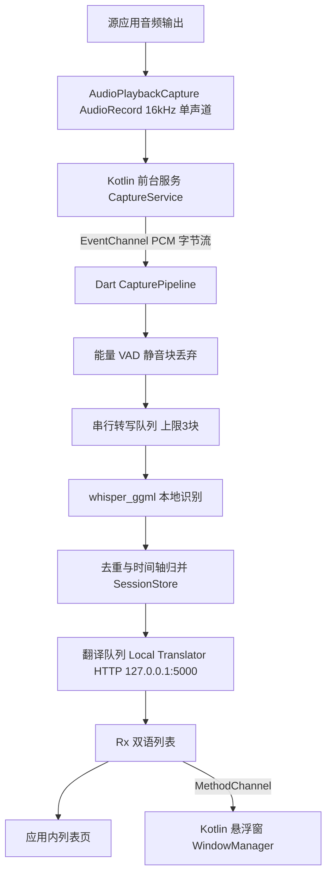

# 系统音频实时字幕翻译应用（LiveSub）

Feature Name: system-audio-subtitles
Updated: 2026-10-11

## Description

独立 Flutter Android 应用：通过 MediaProjection + AudioPlaybackCapture 抓取其他应用播放的音频，按小分块连续喂本地 whisper（whisper_ggml）识别法语字幕，调用 dev.davidv.translator 的 LibreTranslate 兼容 HTTP 服务翻译，双语字幕经系统悬浮窗覆盖显示，应用内提供完整列表与导出。

复用策略（取两者之优、快速实现、bug 少）：

| 能力 | 来源 |
| --- | --- |
| whisper 转写封装（模型池、keepModelLoaded、线程数、错误约定） | 移植 myPiliPlus `local_subtitle_service.dart` |
| 模型目录扫描与命名解析（Download/piliplus_models） | 移植 `model_manager.dart`（含 refresh/导入修复版） |
| 翻译链（HttpSubtitleTranslator + 词库兜底 + 服务探测） | 移植 `subtitle_translator.dart` 及词库资产 |
| 块间去重与时间轴换算思路 | 参考 `incremental_recognizer.dart`，按流式管线重写 |
| 系统音频采集、前台服务、悬浮窗 | 新写 Kotlin（android/app 内原生代码 + MethodChannel） |

## Architecture



要点：

- 采集、前台服务、悬浮窗用 Kotlin 写在 android/app（不引第三方插件），Dart 只做识别/翻译/UI，减少依赖面。
- AudioRecord 直接以 16000 Hz、MONO、PCM_16BIT 的 AudioFormat 构建（框架负责重采样），PCM 块按 chunk 秒数（默认 8s）攒满后整块传 Dart；Dart 侧写临时 WAV（16k mono）供 whisper_ggml 读取，与 myPiliPlus 的临时文件模式一致。
- 转写严格串行（同一时刻仅一个原生转写在跑，天然规避 myPiliPlus 里"僵尸转写"并发问题）；队列积压超上限丢最旧块并在时间轴留缺口标记。
- 时间轴：块 k 覆盖会话时间 `[k*chunkSec, (k+1)*chunkSec)`，分段绝对时间 = 块起点 + 分段相对秒；悬浮窗展示顺序按绝对时间。

## Components and Interfaces

### CaptureService（Kotlin 前台服务）

- `start(mediaProjectionResultData, chunkSeconds)` / `stop()`（MethodChannel）
- 常驻通知「停止捕获」action；Android 14+ 声明 `FOREGROUND_SERVICE_MEDIA_PROJECTION` 类型
- AudioRecord 读满一个块 → EventChannel 发 `ByteData`（PCM16LE）
- 首块回调后开始累计静音时长统计（判定捕获被拒收）回传 Dart

### OverlayController（Kotlin WindowManager）

- `TYPE_APPLICATION_OVERLAY`，默认贴底居中，可拖动，位置存 SharedPreferences
- 折叠态：最近 1 条双语两行；点按展开最近 10 条 RecyclerView；再点折叠
- Dart → Kotlin 仅推数据（原文/译文/是否稳定），Kotlin 无业务逻辑

### CapturePipeline（Dart）

```dart
class CapturePipeline {
  Stream<CaptureChunk> pcm;          // 来自 EventChannel
  Future<void> start(RecognitionSettings s);
  Future<void> stop();
  RxList<SessionSegment> segments;   // 双语结果
}
```

- VAD：块内 20ms 窗 RMS，语音窗占比 < 15%（即静音 >85%）判静音块
- 转写：移植 `LocalSubtitleService.transcribeWithModel`（small 默认 threads=4）
- 去重：相邻块首尾文本重叠裁剪（沿用 incremental_recognizer 策略）
- RTF 监控：最近 10 块平均 RTF > 0.9 时提示建议换小模型（仅提示）

### TranslatorClient（Dart）

- 移植 `subtitle_translator.dart`：`TranslationProvider.autoLocal` 链 = 本地 Offline Translator → GlossaryTranslator
- 端点默认 `http://127.0.0.1:5000/translate`，2s 超时，失败重试 ≤2

### ModelScanner（Dart）

- 移植 `model_manager.dart`：扫描 `Download/piliplus_models`，解析 ggml 文件名得档位档位与量化，`refresh()` 运行期重扫

## Data Models

```dart
class SessionSegment {
  int absStartMs;   // 会话绝对时间
  int absEndMs;
  String text;      // 法语原文（稳定后不再修改）
  String? translation;
  TranslationOrigin origin; // local / glossary / none
  bool stable;      // 非最后一块产出即为 true
}

class SessionRecord {   // 持久化 JSON，保留最近 20 场
  String id; DateTime startedAt; String modelId;
  List<SessionSegment> segments;
}
```

持久化：应用文档目录 `sessions/<timestamp>.json`；导出 SRT 与双语 txt 到 `Download/livesub/`。捕获到的 PCM 只存在于内存与临时文件，转写完成立即覆盖，不落盘原始录音。

## Correctness Properties

1. 分段绝对时间单调不减；缺口（丢块/静音大块）不产生伪造时间。
2. 同一时刻至多一个原生 transcribe 在执行。
3. 悬浮窗内容恒等于会话内绝对时间最新的稳定分段。
4. 导出 SRT 时间轴 = 会话时间轴，不引入偏移。
5. 停止捕获后 AudioRecord、MediaProjection、前台服务通知全部释放。

## Error Handling

| 场景 | 处理 |
| --- | --- |
| 目标应用禁止捕获（全静音） | 提示 + 累计静音秒数，会话继续 |
| MediaProjection 授权被拒/中途撤销 | 结束会话并清理前台服务 |
| 模型缺失 | 阻止开始，跳转模型选择 |
| whisper 加载或转写失败 | 该块记失败，跳过继续（重试 ≤2 次） |
| 翻译服务离线 | 词库兜底并标注来源，设置页一键探测 |
| 悬浮窗无权限 | 引导系统设置；主界面列表不受影响 |
| 队列积压（RTF>1） | 丢最旧块 + 缺口标记 + 换小模型提示 |

## Test Strategy

- 单元：VAD 判定、去重裁剪、时间轴换算、SRT 导出（fixture PCM/文本）
- 集成（真机清单）：YouTube/浏览器/本地播放器各测一次捕获与 DRM 拒捕；旋转与后台存活；Android 10/14 各一台（FGS 类型差异）
- 翻译：本地起 LibreTranslate mock HTTP 验证超时回退与链顺序
- 悬浮窗：拖动持久化、展开 10 条、无权限引导

## Milestones（建议）

1. M1：Kotlin 采集 + Dart 识别打通（无 UI，日志出字）——验证真机延迟与 RTF
2. M2：应用内双语列表 + 翻译链 + 模型选择
3. M3：悬浮窗 + 前台服务通知 + 导出/会话持久化
4. M4：设置项、会话历史、打磨

## References

[^1]: (myPiliPlus#lib/services/local_subtitle) - 转写封装/模型管理/翻译链/去重策略
[^2]: (Offline Translator) - dev.davidv.translator 的「Enable LibreTranslate compatible HTTP server」
[^3]: Android AudioPlaybackCapture API（API 29+，capture policy 行为）
