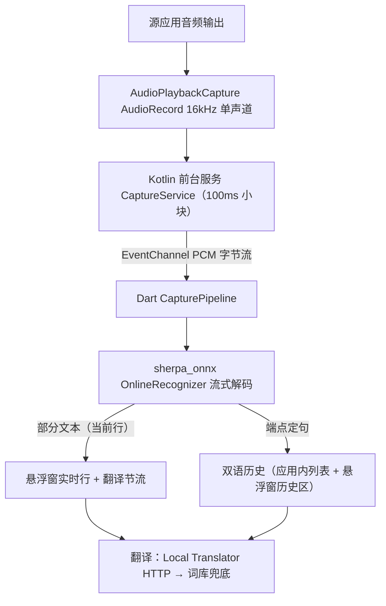

# 系统音频实时字幕翻译应用（LiveSub）

Feature Name: system-audio-subtitles
Updated: 2026-10-12

## Description

独立 Flutter Android 应用：通过 MediaProjection + AudioPlaybackCapture 抓取其他应用播放的音频，以 100ms granularity 连续喂 **sherpa-onnx 流式 zipformer** 实时识别法语字幕（实测延迟为 whisper 整块转写的零头），调用 dev.davidv.translator 的 LibreTranslate 兼容 HTTP 服务翻译，双语字幕经系统悬浮窗覆盖在任意应用之上显示，应用内提供双语列表。

### 历史修订

- 初版设计用 whisper_ggml 按 8s 块串行转写，真机 RTF≈5，出词追不上播放；2026-10-12 起换 sherpa-onnx 流式内核（`sherpa_onnx` pub 包 1.13.8 + `sherpa_onnx_android_arm64` 预编译 .so，模型 `sherpa-onnx-streaming-zipformer-fr-kroko-2025-08-06`，57MB）。whisper_ggml 已从 pubspec 移除。

复用策略（取两者之优、快速实现、bug 少）：

| 能力 | 来源 |
| --- | --- |
| 流式识别 API（OnlineRecognizer/OnlineStream/端点） | sherpa-onnx 官方 flutter-examples/streaming_asr |
| 模型下载 | dio 逐文件流式下载（hf-mirror），无系统解压依赖 |
| 翻译链（HttpSubtitleTranslator + 词库兜底） | 移植 `subtitle_translator.dart` |
| 系统音频采集、前台服务、悬浮窗 | 新写 Kotlin（android/app 内原生代码 + MethodChannel） |

## Architecture



要点：

- 采集、前台服务、悬浮窗用 Kotlin 写在 android/app（不引第三方悬浮窗插件），Dart 只做识别/翻译/UI。
- **FGS 顺序**：Android 14+ 必须先 `getMediaProjection` 拿到 MediaProjection 再 `startForeground(mediaProjection type)`，顺序颠倒直接 SecurityException。
- **流式识别**：PCM16LE → Float32List → `acceptWaveform` → `while(isReady) decode` → `getResult`；`isEndpoint` 时 reset 并从零继续计句，天然断句。静音由识别器内部处理，无需自建 VAD 丢块。
- **块粒度**：100ms/块喂识别兼顾延迟与 JNI 开销；静音占比仅用于统计提示，不再跳块（跳块会破坏流式上下文）。
- **悬浮窗**：`TYPE_APPLICATION_OVERLAY` 挂在 **applicationContext**（Activity 销毁不影响，前台服务保进程），View 树 = 历史区(最近 6 条) + 当前行(大字 FRA) + 译文行(黄色 ZH)；整块可拖动（ACTION_MOVE 更新 LayoutParams），轻点清空历史。位置本版本不持久化。
- **翻译节流**：当前行每 ≥1.2s 且文本有变化才发起一次翻译，回调时校验句子仍是同一句才上屏；端点定句时若无译文再补翻一次回填历史。

## Components and Interfaces

### CaptureService（Kotlin 前台服务）

- `startCapture`（MethodChannel，`chunkMillis` 默认 100）/ `stopCapture()`
- 常驻通知「停止捕获」action；严格按 startForeground 前完成 `getMediaProjection`（Android 14+ FGS 类型校验）
- AudioRecord 每 100ms → EventChannel 发 `{bytes: ByteArray, silenceRatio: Double}`（静音占比仅做统计）

### OverlayController（Kotlin WindowManager 单例）

- `TYPE_APPLICATION_OVERLAY` + **applicationContext**（悬浮窗存活随进程，前台服务保证不被杀）
- 结构：历史区（最近 6 条双语灰字）+ 当前行（18sp 白 FRA）+ 译文行（15sp 黄 ZH）
- `update(fr, zh)` 刷当前行；`pushLine(fr, zh)` 进历史区；整块拖动更新 LayoutParams；轻点清空历史
- 拖动位置持久化与点按展开列表暂未实现（见 tasklist 遗留项）
- Dart → Kotlin 仅推数据（`livesub/overlay` MethodChannel），Kotlin 无业务逻辑

### CapturePipeline（Dart）

```dart
class CapturePipeline {
  Future<void> start();          // 选模型→init 识别器→开采集
  Future<void> stop();
  RxList<RecognizedSegment> history; // 定句后的双语历史
  RxString latestFr, latestZh;   // 当前行（实时）
  RxBool overlayShowing;
}
```

- 识别：`SherpaRecognizer` 封装 `initBindings` + `OnlineRecognizer(在线 transducer, numThreads=4)`；`acceptChunk(Float32List)` 返回 `SherpaChunk(text, isEndpoint)`，端点即 reset
- 部分结果每 chunk 直接刷当前行与悬浮窗；译文每 ≥1.2s 变化一次才翻，回调校验仍是同一句才上屏（避免旧译文覆盖新句）
- 定句：端点触发 → 写历史 +(若未译)补翻回填 → `pushLine` 推悬浮窗历史区

### TranslatorClient（Dart）

- 移植 `subtitle_translator.dart`：本地 Offline Translator → GlossaryTranslator 链
- 端点默认 `http://127.0.0.1:5000/translate`，2s 超时，失败回退

### ModelStore（Dart `model_dir.dart` + `model_download.dart`）

- 扫描候选根目录（公共 `Download/piliplus_models` → 应用私有回退），校验模型子目录内 `encoder/decoder/joiner/tokens` 齐备且非空
- 下载：逐文件（encoder/decoder/joiner.onnx + tokens.txt）从 hf-mirror `resolve/main` 下载 `*.part` 临时文件 → 按精确字节数校验 → rename 原子落盘；文件名固定来自内置表，无路径穿越面（国内直连 github release 不通，hf-mirror 可用）
- kroko 模型 `modelType` 必须为 `zipformer2`（配 `zipformer` 原生报 `'attention_dims' does not exist`，桌面 dart 端可离线复现）

## Data Models

```dart
class RecognizedSegment {  // 定句后入历史
  String fr;        // 法语原文
  String? zh;       // 中文译文（补翻后回填）
  DateTime timestamp;
}
```

会话文本持久化与 SRT 导出暂未实现；捕获到的 PCM 只存在于内存，不落盘任何音频。

## Correctness Properties

1. 流式 reset 后新句从零开始，历史顺序即句序。
2. 同一时刻至多一个 sherpa 原生识别实例（识别器独占，chunk 同步喂入）。
3. 译文回调仅在「句子仍是发起翻译的那句」时上屏（防迟到译文覆盖新句）。
4. 悬浮窗内容 = 当前行或最近定句双语（由 Kotlin 视图保证）。
5. 停止捕获后 AudioRecord、MediaProjection、前台服务通知全部释放；`stop()` 释放识别器。
6. 模型下载只写 `<root>/<dirName>/<内置文件名>`；落盘前写 `.part`，校验字节数后 rename。

## Error Handling

| 场景 | 处理 |
| --- | --- |
| 目标应用禁止捕获（全静音） | 提示 + 静音统计，会话继续 |
| MediaProjection 授权被拒/中途撤销 | 结束会话并清理前台服务 |
| sherpa 模型缺失或加载失败 | 阻止开始，主界面下载/扫描入口 |
| 下载中断/文件字节数不符 | 主界面红字显示具体原因，清理 `.part`，可重试 |
| 翻译服务不可用 | 词库兜底，原文照常显示 |
| 悬浮窗无权限 | 跳系统「显示在其他应用上层」设置，返回后自动生效 |
| 识别器 init 后原生报错 | 状态条提示，会话终止不重试加载 |

## Test Strategy

- 单元/离线：识别器配置桌面复现（真实 kroko 模型 + 同 config 在 linux dart 实测出正确法语，锁定 modelType=zipformer2）；模型子目录齐备性校验
- 集成（真机清单）：流式延迟主观对比；端点断句频率（过长合并/过破碎片需调 rule1/2 静音阈值）；YouTube/浏览器捕获；旋转与后台存活；悬浮窗覆盖 + 拖动；Android 14+ FGS 顺序回归
- 翻译：LibreTranslate mock 验证超时回退与链顺序

## Milestones（实际进度）

1. ✅ M1：Kotlin 采集 + Dart 识别打通（whisper 块式，真机 RTF≈5 太慢）
2. ✅ M2：悬浮窗显示双语 + sherpa 流式内核切换 + 模型下载（2026-10-12）
3. M3（待做）：会话持久化/SRT 导出、设置页（块长/端点阈值/翻译端点/悬浮窗样式）、位置持久化
4. M4（待做）：识别效果调优（端点规则、模型换型）、多语言模型下载扩展

## References

[^1]: (myPiliPlus#lib/services/local_subtitle) - 转写封装/模型管理/翻译链/去重策略
[^2]: (Offline Translator) - dev.davidv.translator 的「Enable LibreTranslate compatible HTTP server」
[^3]: Android AudioPlaybackCapture API（API 29+，capture policy 行为）
